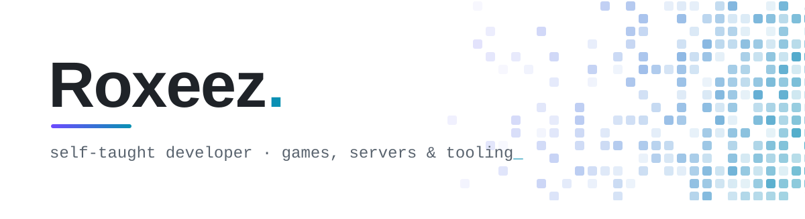

<picture>
  <source media="(prefers-color-scheme: dark)" srcset="assets/banner-dark.svg">
  
</picture>

Based in Lille, I've been writing code around games for years: servers,
tools that hook into game clients, libraries other developers build on.

Self-taught, one project at a time, and a senior developer today. Games are what
I build in my own time.

<picture>
  <source media="(prefers-color-scheme: dark)" srcset="assets/stack-dark.svg">
  
</picture>

### What I enjoy
- **Understanding how games work under the hood**: network protocols, packet formats,
  file formats, and what a client actually does with the data it receives.
- **Building servers that hold up**: game logic, persistence, services that talk to each
  other, and deploying it all.
- **Writing tools for other developers**: small libraries with a clean API, the kind
  you can pick up in five minutes.
- **Clean code**: clear names, consistent conventions, and an architecture that still
  makes sense a year later.

### How I got here
- **Minecraft**: my first public projects were plugins and APIs for Bukkit/Spigot servers.
- **NosTale tooling**: then came libraries to read and drive the game client, from
  process memory to packets, up to TaleKit, an API to build NosTale applications.
- **Games on the side**: a 2D platformer and a space MMO, both in Unity.
- **Game servers**: a Minecraft server in C# with Minesharp, then the project below.

### Currently working on
**Nosdawn**: a NosTale server built from scratch in C# with .NET 10.
Not a fork of any existing emulator: the server, the launcher, the client patching
and the debugging tools are all made in-house.

### Some things I've shared
| Project | What it does |
|---|---|
| [NProcess](https://github.com/Roxeez/NProcess) | Read and drive local or remote processes: memory, threads |
| [AdvancementAPI](https://github.com/Roxeez/AdvancementAPI) | Custom advancements for Bukkit/Spigot servers |
| [TaleKit](https://github.com/TaleFactory/TaleKit) | Packet-based library to build NosTale applications |
| [Orbita](https://github.com/Roxeez/Orbita) | Multiplayer 2D space MMO built with Unity |
| [Hadar](https://github.com/Roxeez/Hadar) | 2D platformer built with Unity |
| [Minesharp](https://github.com/MinesharpMC/Minesharp) | Minecraft server written in C# |

### Get in touch
Reach me on Discord: [**roxeez**](https://discord.com/users/353956120814944268)

<picture>
  <source media="(prefers-color-scheme: dark)" srcset="https://raw.githubusercontent.com/Roxeez/Roxeez/output/snake-dark.svg">
  
</picture>
